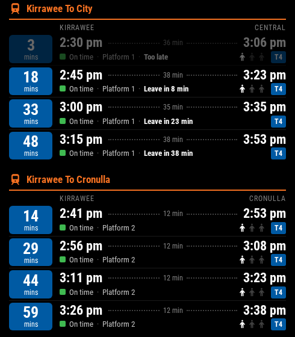

# MMM-SydneyTrains

A [MagicMirror²](https://magicmirror.builders/) module that shows real-time Sydney Trains departures from the Transport for NSW API, laid out like a trip planner: how long until each train, when it leaves, and when it gets to your stop.



## Features

- Show several routes or stations at once
- A countdown tile for each train, in its line's colour
- Departure and arrival times for your trip, with the trip length between them
- Real-time status: on time, minutes late or early, cancelled, or scheduled when there's no real-time data
- How full the train is, and a warning for short trains
- **Leave-by times**: add your walk to the station and each train says when to leave, so trains you can't make are dimmed
- Important alerts for the route, such as trackwork
- Filter each route by line (e.g. `T1`) and destination
- Routes live in a separate `routes.json` file, picked up on the next refresh without restarting the mirror

## Requirements

This module uses the [Transport for NSW Open Data Hub](https://opendata.transport.nsw.gov.au/) **Trip Planner APIs** (trip and departure monitor endpoints).

- You need a free API key: register on the Open Data Hub, create an application, and add the **Trip Planner APIs** to it.
- The free plan has request quotas; check the current limits on the portal. With the default settings the module makes one request per route every 60 seconds (about 1,440 requests per route per day).

The module uses the built-in `fetch` in Node.js, so it has no npm dependencies.

## Installation

```bash
cd ~/MagicMirror/modules
git clone https://github.com/lachie-92/MMM-SydneyTrains.git
cd MMM-SydneyTrains
cp routes.example.json routes.json
```

Then edit `routes.json` (see [Routes](#routes)) and add the module to your config.

## Configuration

Add this to the `modules` array in `~/MagicMirror/config/config.js`:

```javascript
{
    module: "MMM-SydneyTrains",
    position: "top_right",
    config: {
        apiKey: "YOUR_TFNSW_API_KEY"
    }
}
```

| Option | Default | Description |
| --- | --- | --- |
| `apiKey` | `""` | **Required.** Your Transport for NSW API key. |
| `updateInterval` | `60000` | How often to refresh, in milliseconds. 30000 (30 seconds) or more is recommended. |
| `maxTrainsPerRoute` | `6` | Maximum number of trains shown per route. |
| `animationSpeed` | `1000` | Fade speed when the display updates, in milliseconds. |
| `routesFile` | `"routes.json"` | Routes file name, relative to the module folder. |
| `showOccupancy` | `true` | Show how full each train is. |
| `showAlerts` | `true` | Show important alerts under the route heading. |
| `timeFormat` | Your MagicMirror² setting | `12` or `24` hour times. |

## Routes

Each entry in `routes.json` is shown as its own section on the mirror:

```json
[
    {
        "id": "central-to-penrith",
        "name": "Central to Penrith",
        "stopId": "10101100",
        "toStopId": "10101252",
        "walkMinutes": 10
    },
    {
        "id": "central-all",
        "name": "Central - All Trains",
        "stopId": "10101100"
    }
]
```

| Field | Required | Description |
| --- | --- | --- |
| `id` | Yes | Unique identifier for the route. |
| `name` | Yes | Heading shown on the mirror. |
| `stopId` | Yes | Transport for NSW stop ID for the station you leave from. |
| `toStopId` | No | Stop ID for the station you get off at. Adds arrival times and the trip length, and only shows trains that go there without a change. Without it, the route shows every train leaving `stopId` and where it's going. |
| `walkMinutes` | No | Minutes it takes to get to the station. Each train then says when to leave. |
| `lineFilter` | No | Only show this line (e.g. `T1`, `T4`). Leave empty for all lines. |
| `destinationFilter` | No | Only show trains whose final destination contains this text. Leave empty for all destinations. |
| `colour` | No | Countdown tile colour for this route, e.g. `"#00954c"`. By default each train uses its line's colour. |

Changes to `routes.json` are picked up on the next refresh, so there's no need to restart MagicMirror².

With `toStopId`, you usually don't need `lineFilter` or `destinationFilter`. The trip planner only returns its best few trips, so a filter can hide all of them. For example, trains from Central to Strathfield may all be T8 rather than T1.

### Finding stop IDs

Run the included script with a station name and your API key:

```bash
node find-stop.js "Town Hall" YOUR_TFNSW_API_KEY
```

```
Town Hall Station, Sydney: 10101101
```

Some common stop IDs:

- Central: `10101100`
- Town Hall: `10101101`
- Wynyard: `10101102`
- Circular Quay: `10101103`
- St James: `10101105`
- Bondi Junction: `10101109`
- Strathfield: `10101206`
- Parramatta: `10101229`
- Penrith: `10101252`
- Redfern: `10101421`

## Reading the display

- **Countdown tile**: minutes until the train leaves, in the line's colour. It pulses when it's time to leave.
- **Times**: when the train leaves and when it arrives at `toStopId`, with the trip length between them. Real-time estimates are used when there are any.
- **Status**: a green square for on time, amber or red for minutes late, blue for early, and an empty square for "Scheduled" when the train has no real-time data. Cancelled trains are crossed out.
- **People icons**: one for plenty of seats, two for a few seats left, three for standing room only. Not every train reports this.
- **"4 cars"** warns about a short train. **"Use cars 1–6"** means only some cars fit the platform.
- **Leave times**: with `walkMinutes` set, "Leave in 5 min", then "Leave now", then "Too late" with the train dimmed.

## Updating

```bash
cd ~/MagicMirror/modules/MMM-SydneyTrains
git pull
```

Your `routes.json` is not tracked by git, so updating won't overwrite it.

## Customisation

Override any styles from `MMM-SydneyTrains.css` in `~/MagicMirror/config/custom.css`, so they survive updates. Each train row sets `--line-colour` for its tile and line badge.

```css
/* Narrower module */
.sydney-trains {
    width: 400px;
}

/* No pulsing tile */
.train-item.leave-now .countdown {
    animation: none;
}
```

## Troubleshooting

- **"API key not configured"**: add `apiKey` to the module's `config` block.
- **"Routes file not found"**: run `cp routes.example.json routes.json` in the module folder.
- **No trains showing**: check your API key, the stop IDs, and that your filters aren't excluding every service. With `toStopId`, only trains that get there without a change are shown.
- **"Update failed"**: the last trains stay on screen. The message shows why the latest update failed.
- **Routes not loading**: make sure `routes.json` is valid JSON.
- **Module not appearing**: check the MagicMirror² logs (e.g. `pm2 logs mm`).

## License

[MIT](LICENSE)
